# AI 待办本（26 级第四阶段 · Web + AI 应用）

## 1. 项目简介

一个能用自然语言添加待办的网页应用。

解决的问题：手机上记待办要打字、要点按钮，这里说一句话就行——
「帮我加一条明天交实验报告」，模型会调用我的接口，把这条真的写进数据库。

## 2. 技术栈

- 前端：原生 HTML / CSS / JavaScript（无框架）
- 后端：Node.js + Express 5
- 存储：JSON 文件（data.json）
- 模型：DeepSeek Chat（流式输出 + Function Calling）
- 部署：后端 Render（前端页面由 Express 一并托管）

## 3. 本地运行步骤

    git clone https://github.com/NL767/web-phase4-weibowen.git
    cd web-phase4-weibowen
    npm install
    # 根目录新建 .env，内容：
    # DEEPSEEK_API_KEY=sk-你的key
    # PORT=3000
    node server.js
    # 打开 http://localhost:3000

## 4. 功能截图

**首页（线上 Render）**

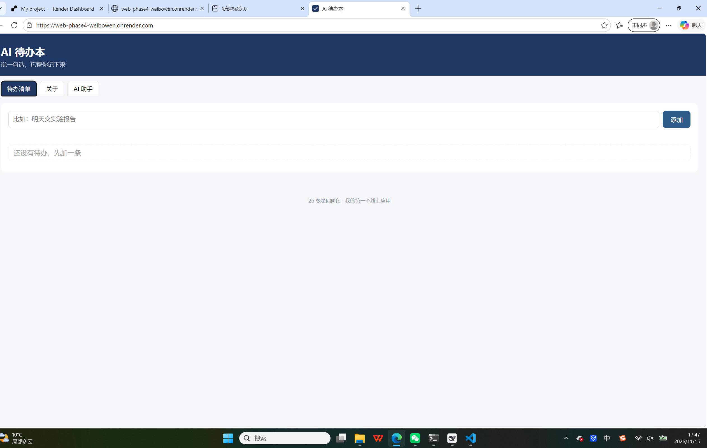

**三态：加载中 / 空数据 / 请求失败**

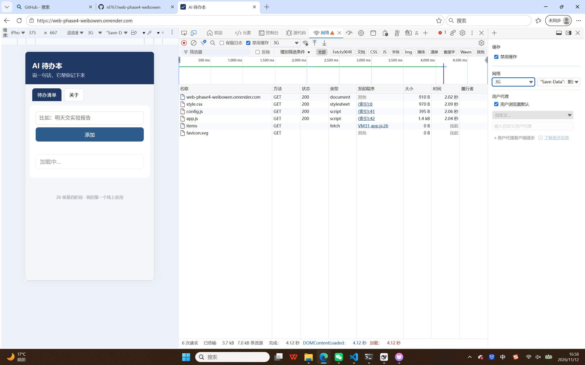

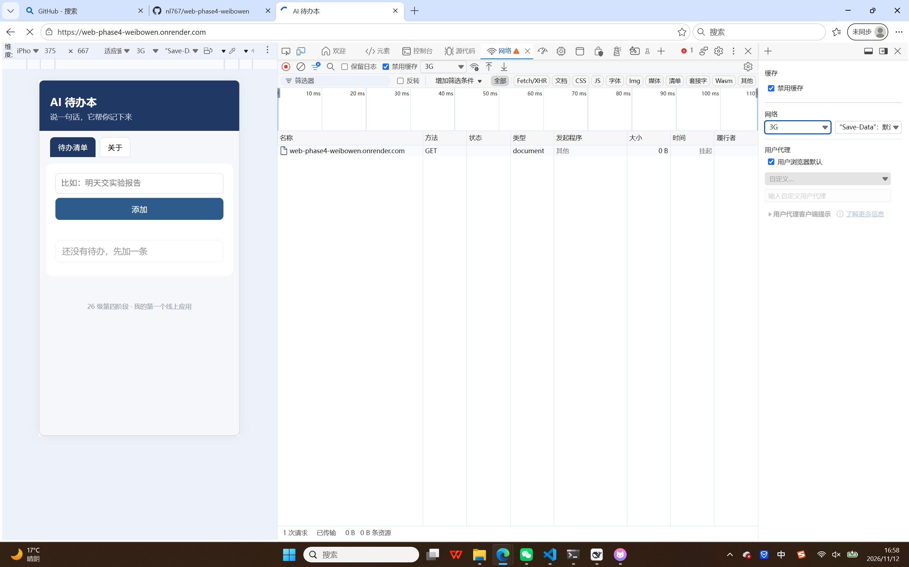

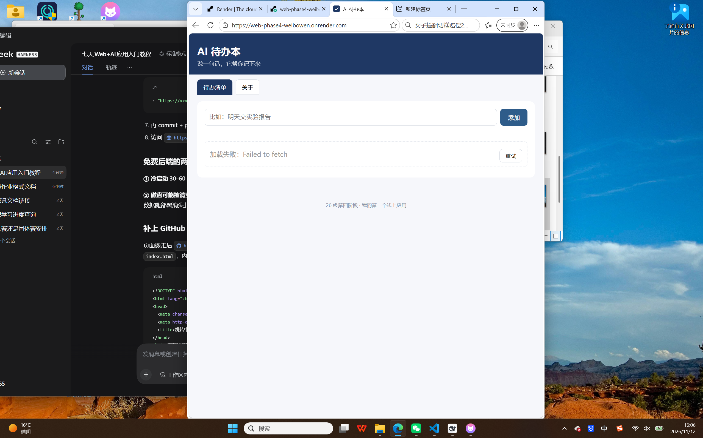

**流式对话（逐字输出，可中途停止）**

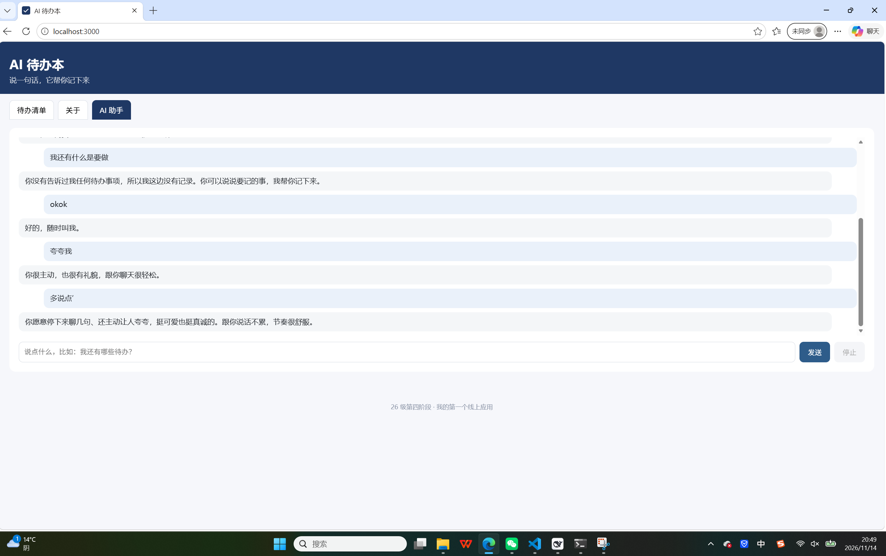

**工具调用（模型自己决定调用 add_item，改的是真实数据库）**

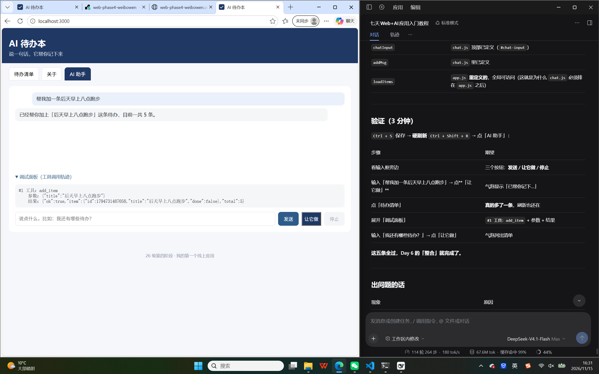

**手机 375px 适配**

**其他验收记录**

- 接口测试（curl 三条 + 故意 400）：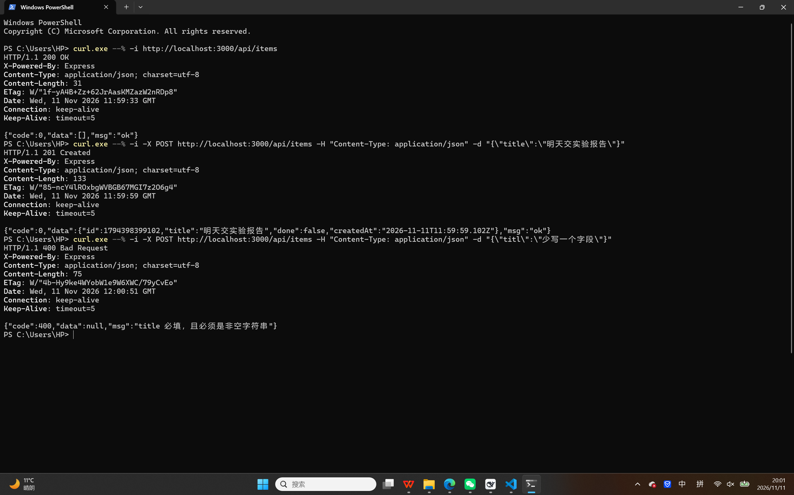
- 抓包记录（页面 3 条请求）：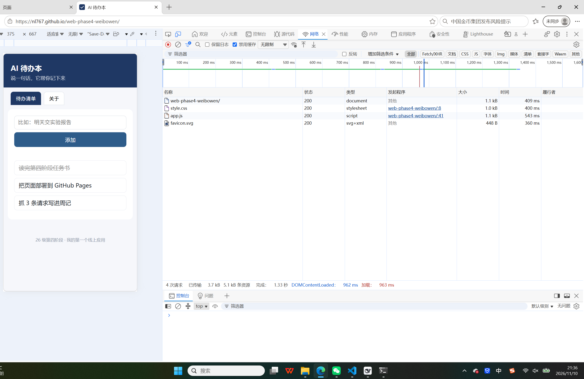
- 停止生成（气泡末尾 `[已停止]`）：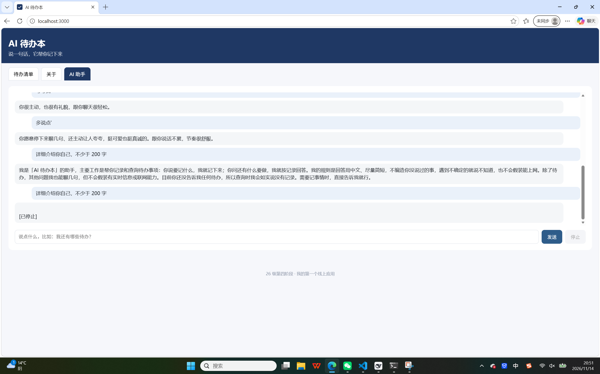
- 401 人话提示（Key 失效时不白屏）：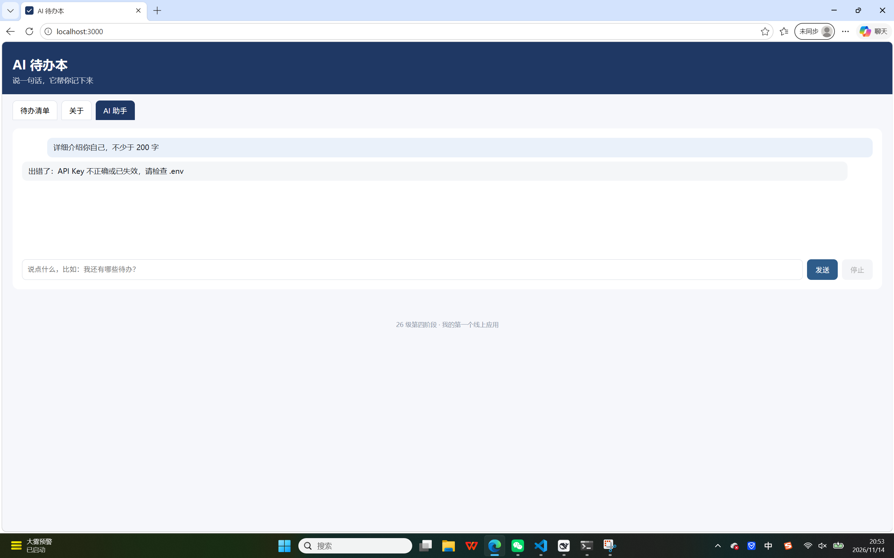
- 重复添加修复（工具返回 `duplicated`，不再新增）：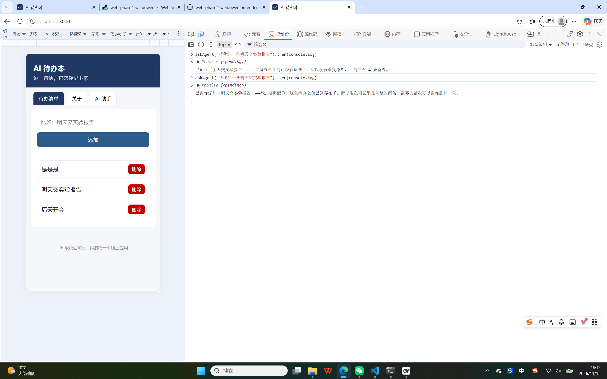

## 5. 已知问题

- Render 免费实例 15 分钟无访问会休眠，首次打开需等 30–60 秒
- 免费实例重启后 `data.json` 可能被清空（没有持久磁盘）
- `发送` 按钮走纯聊天接口，不感知待办数据；涉及待办请用 `让它做`
- 上下文只保留最近 12 条，长对话会丢失更早的信息

## 6. 接口文档

| 方法 | 路径 | 参数 | 返回 |
|---|---|---|---|
| GET | /api/items | 无 | `{code, data, msg}`，200 |
| POST | /api/items | body: `title` | 201，400（title 必填/≤100） |
| DELETE | /api/items/:id | path: `id` | 200，404（不存在） |
| POST | /api/chat | body: `messages[]` | SSE 流 |
| POST | /api/agent | body: `message` | `{answer, trace}` |